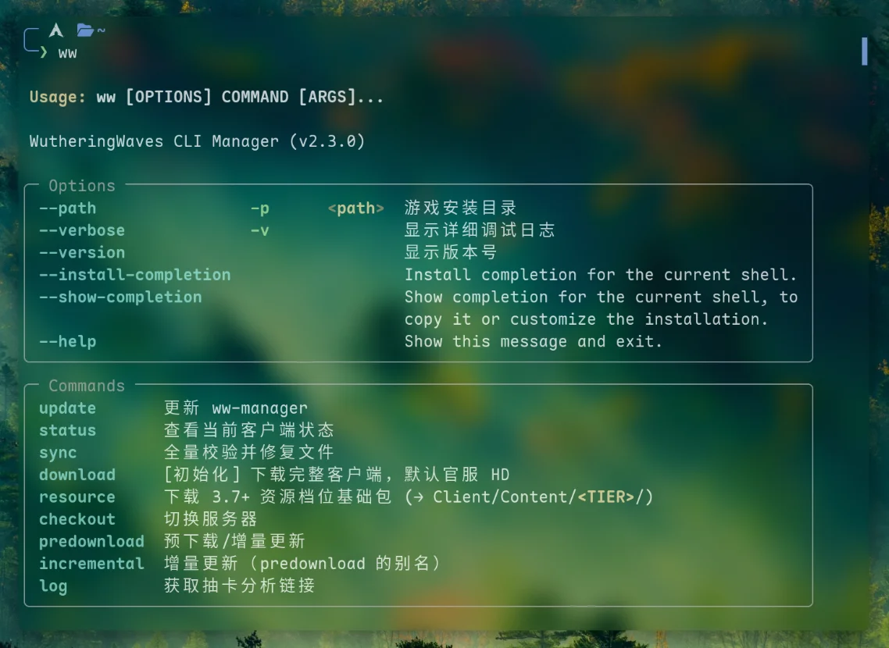
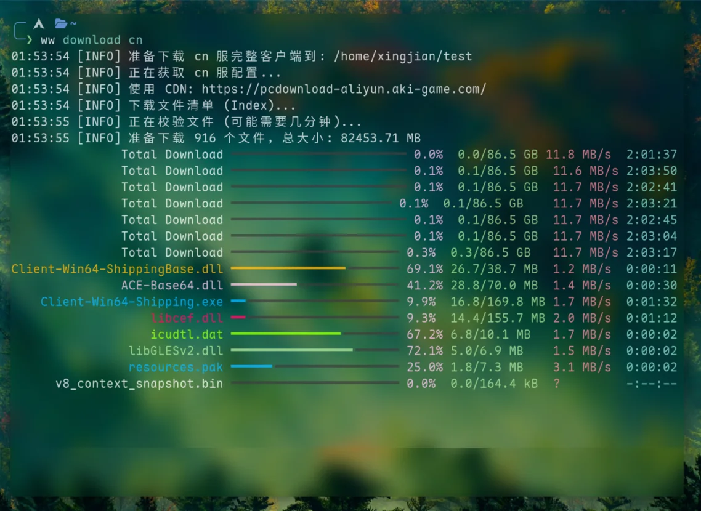

<div align="center">
  <h1>WutheringWaves CLI Manager</h1>
  <h3>Command-line manager for Wuthering Waves</h3>
  <a href="https://python.org"></a>&nbsp;<a href="https://github.com/astral-sh/uv"></a>&nbsp;
</div>

<p align="center">
  
  
</p>

A command-line tool for downloading the Wuthering Waves client, updating and repairing files, managing quality packs, and switching servers.

This project only downloads, updates, and manages client files. It does not launch the game. See [Launching the game](#launching-the-game) below.

[中文](../README.md)

## Installation

### uv (recommended)

Install uv if you do not already have it:

```bash
# Linux / macOS
curl -LsSf https://astral.sh/uv/install.sh | sh
```

```powershell
# Windows PowerShell
powershell -ExecutionPolicy ByPass -c "irm https://astral.sh/uv/install.ps1 | iex"
```

Reopen your terminal, then install this tool:

```bash
uv tool install ww-manager
```

### AUR

```bash
yay -S ww-manager
```

### From source

Requires Git and uv:

```bash
git clone https://github.com/timetetng/wutheringwaves-cli-manager.git
cd wutheringwaves-cli-manager
uv tool install .
```

### Updating and uninstalling

Update the tool:

```bash
ww update
```

Uninstall a uv installation, including the source installation above:

```bash
uv tool uninstall ww-manager
```

Uninstall an AUR installation:

```bash
yay -R ww-manager
```

## Quick start

Specify your game installation directory on first use. The tool remembers this path:

```bash
ww -p "$HOME/Games/WutheringWaves" download
```

Use the menus to select a server and quality tier, then confirm to download. You can also use an existing game directory; valid files are reused.

Windows path example:

```powershell
ww -p "D:\Games\WutheringWaves" download
```

Check the current status:

```bash
ww status
```

You do not need to specify the path again. To change directories, use `-p` with the new path.

## Launching the game

Pass the launch argument for an installed quality tier:

| Tier | Launch argument |
|---|---|
| SD · Standard | `-krqlv=sd` |
| HD · High | `-krqlv=hd` |
| UHD · Ultra | `-krqlv=uhd` |

For example, use `-krqlv=hd` after installing HD. Changing the tool's default tier does not automatically change your game launch configuration.

For Linux launch instructions and troubleshooting, see the [Linux guide](linux.md) (Chinese).

## Common commands

| Command | Purpose |
|---|---|
| `ww download` | Download the client; select a server and quality tier in the menus |
| `ww resource` | Manage quality packs |
| `ww checkout` | Switch servers |
| `ww status` | Show game and tool status |
| `ww predownload` | Download an incremental update |
| `ww predownload --apply` | Apply a downloaded incremental update |
| `ww sync` | Verify and repair files |
| `ww log` | Get the gacha history link |
| `ww update` | Update the tool |

`download`, `resource`, and `checkout` open menus when called without arguments. You can also specify arguments directly:

```bash
ww download bilibili HD
ww resource UHD
ww checkout cn
```

Use ↑↓ to select, Enter to confirm, and Esc to cancel. In the resource menu, press `d` to delete the highlighted tier; confirmation is required.

Server arguments: `cn` for the official Chinese server, `bilibili` for the Bilibili server, and `global` for the international server. `incremental` is an alias for `predownload`.

For available options:

```bash
ww --help
ww resource --help
```

## Further documentation

- [Linux launch instructions and troubleshooting](linux.md) (Chinese)
- [Running the official launcher on Linux](wuwa-launcher.md) (Chinese)

## Feedback

Open an Issue with the command you ran, the tool version, and relevant logs. Pull requests are also welcome.

## Acknowledgements

- [WutheringWavesTool](https://github.com/leck995/WutheringWavesTool)
- [LutheringLaves](https://github.com/last-live/LutheringLaves)
- [wuwa-uhd-tool](https://github.com/TianXyousa/wuwa-uhd-tool)
- [Wuthering-Waves-Official-Bilibili](https://github.com/Hurry1027/Wuthering-Waves-Official-Bilibili)
- [GE-Proton](https://github.com/GloriousEggroll/proton-ge-custom)
- [dwproton](https://dawn.wine/dawn-winery/dwproton/releases)
